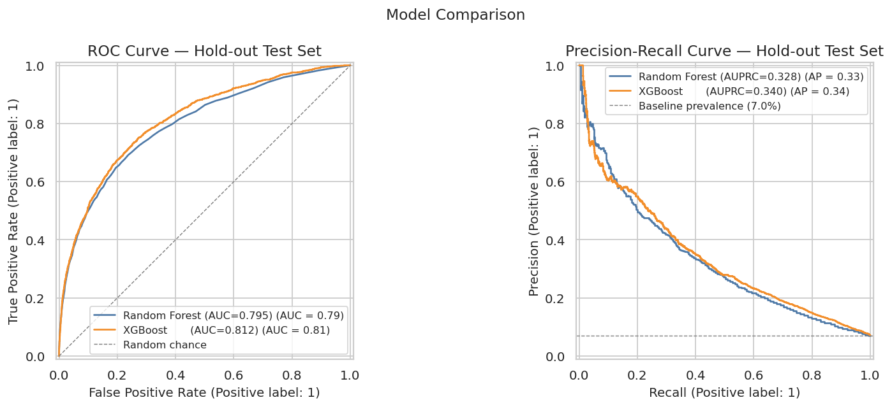
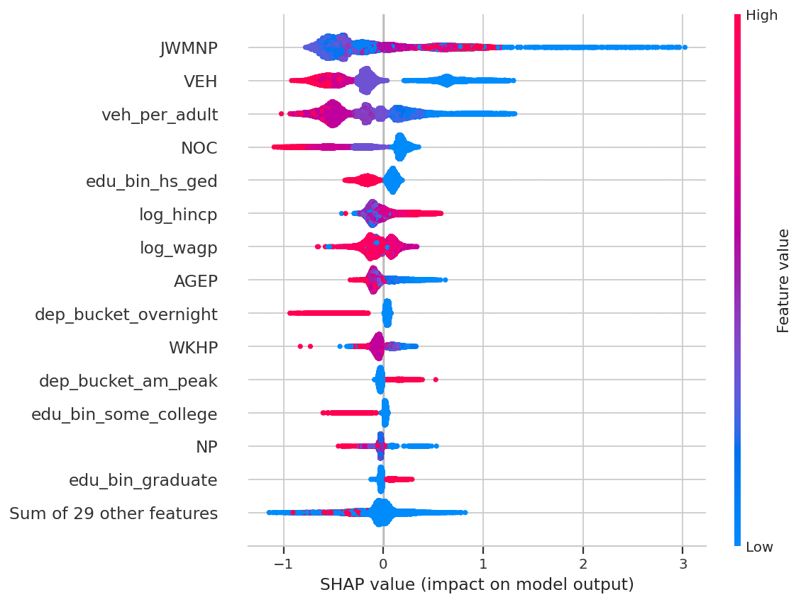
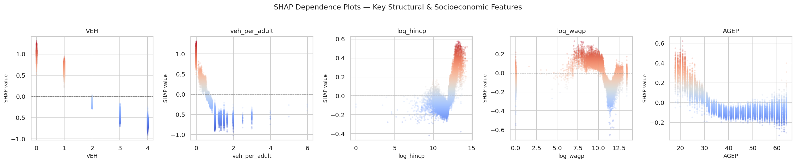
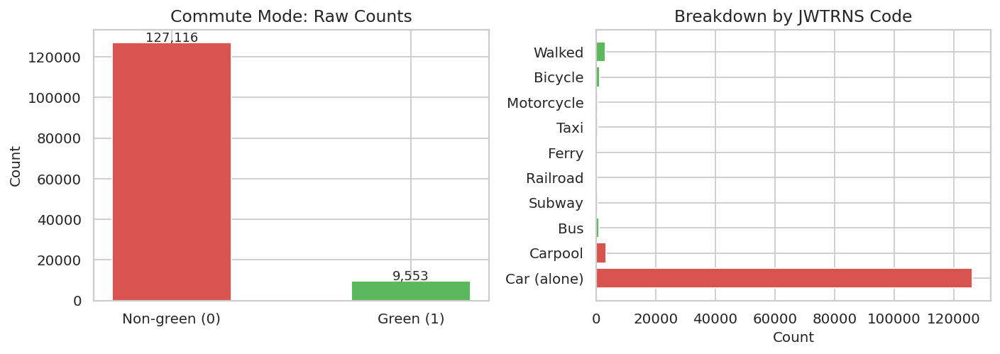

# Green Commuting in California: An Interpretable ML Approach

Who takes the bus, rides a bike or walks to work, and what stands in the way for everyone else? This project predicts **"green" commuting** (public transit, walking, cycling) for California workers from socioeconomic and structural factors, then uses **explainable ML (SHAP and partial dependence)** to show *which* factors matter and *how*.

*Final project for Machine Learning for Public Informatics, Rutgers University (Spring 2026).*



## Key results

| Model | ROC-AUC | AUPRC |
|---|---|---|
| Random Forest (baseline, balanced class weights) | 0.795 | 0.328 |
| **XGBoost** (tuned, `scale_pos_weight`) | **0.812** | **0.340** |

Hold-out test set, 20% stratified split. Only about 7% of commuters commute green, so random guessing would give an AUPRC of about 0.07. **XGBoost is roughly 5× better than chance** at finding green commuters.

**What drives green commuting (SHAP):**

- **Car access is the strongest structural barrier.** Workers in households with 0 or 1 vehicles are far more likely to commute green. Beyond 2 vehicles, the effect turns clearly negative.
- **Travel time** is the top feature, because green commutes in California take longer on average (35 vs. 29 minutes).
- **Households with children** commute green less often.
- **Younger workers (under ~30)** commute green more often. Income has a non-linear effect: higher household income raises the probability at the top end, while mid-to-high personal wages lower it.





## Data

**American Community Survey Public Use Microdata Sample (ACS PUMS) 2024 1-year estimates, California person file**, with 20 variables including:

| Variable | Meaning |
|---|---|
| `JWTRNS` | Means of transportation to work (target) |
| `VEH` | Vehicles available in household |
| `HINCP`, `WAGP` | Household income, wage income |
| `AGEP`, `SEX`, `SCHL` | Age, sex, educational attainment |
| `NP`, `NOC` | Persons in household, number of own children |
| `JWMNP`, `JWDP` | Travel time to work, departure time |
| `OCCP`, `WKHP`, `ESR` | Occupation, hours worked, employment status |

The data can be downloaded from the [Census Bureau's microdata tool](https://data.census.gov/mdat/). It is not included in this repository.

## Methods

All code is in [`green_commuting_ml.ipynb`](green_commuting_ml.ipynb) (Python: polars, scikit-learn, XGBoost, SHAP).

1. **Sample:** employed adults aged 18–64 with a valid commute mode (393,725 → 142,522 workers). People who work from home are excluded.
2. **Target:** green = bus, subway, rail, light rail, ferry, bicycle, or walking (6.7% of the sample, a 13.9 : 1 imbalance).
3. **Feature engineering:** log income, vehicles per adult, education and departure-time bins, occupation groups.
4. **Preprocessing pipeline:** scaling and one-hot encoding inside a scikit-learn `ColumnTransformer`, fitted on training data only.
5. **Imbalance handling:** class re-weighting rather than accuracy. Evaluated with **ROC-AUC, AUPRC and F1** using 5-fold stratified cross-validation. SMOTE was also tested as an alternative.
6. **Models:** Random Forest baseline; XGBoost tuned with a randomized search (30 candidates, 5-fold CV, optimizing AUPRC), plus early stopping and F1-optimal threshold selection.
7. **Interpretation:** SHAP TreeExplainer (global importance, beeswarm, dependence plots) and partial dependence plots.



## Limitations

- **Predictive, not causal.** SHAP shows what the model relies on, not what would happen if a factor changed.
- **Travel time is partly an outcome of mode choice.** Transit trips are slower, so its high importance partly reflects that rather than a cause.
- **No spatial context.** Place-of-work geography was over 50% missing, so transit availability near home or work is not in the model. This is the obvious next step.
- **Survey weights were not used** in training, so results describe the sample rather than the weighted California workforce.

## Run it yourself

```bash
pip install -r requirements.txt
```

Put the PUMS extract at `data/ACSPUMS2024.csv` (or set `DATA_PATH` in the first cell) and run the notebook top to bottom. It also runs in Google Colab.

## Repository structure

```
green_commuting_ml.ipynb   data cleaning, EDA, models, SHAP and PDP analysis
figures/                   result plots used in this README
requirements.txt           Python dependencies
```

## Author

**Sina-Marie Mayer** · [Portfolio](https://sinamayer.github.io) · [GitHub](https://github.com/sinamayer) · [LinkedIn](https://www.linkedin.com/in/sina-marie-mayer-5a8b71379)
